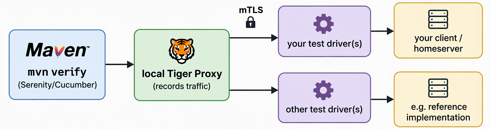

:toc-title: Table of contents
:toc:
:toclevels: 2
:sectanchors:
:source-highlighter: prettify
:sourcedir: ../../src
:rootdir: ../../
= Getting Started with the TI-Messenger-Testsuite

This guide takes you from the first checkout to a test report and a test suite that runs in your CI pipeline.
Work through the chapters in order.
Background on the concept, tags and filters is in the German link:Testsuite.adoc[test suite documentation].

[#_prerequisites]
== Prerequisites

* JDK 21, Maven 3.9.x (tested on version 3.9.15), Git
* One test driver per TI-Messenger client or org admin client you want to test, implementing the link:{sourcedir}/main/resources/api/TiMessengerTestTreiber.yaml[test driver interface]
* mTLS certificates from gematik (see <<_set_up_certificates>>), but there are ways to start without them (see <<_disable_tls>>).

*Windows:* the repository contains long paths.
Before cloning, run `git config --system core.longpaths true` in Git Bash as administrator (or `git config --global core.longpaths true` if that fails).

[#_get_the_test_suite]
== Get the test suite

You can clone the test suite from GitHub or download a release.
But in case you want to propose a PR (see link:{rootdir}CONTRIBUTING.md[CONTRIBUTING.md]), you need a fork of the repository (see https://docs.github.com/en/pull-requests/how-tos/work-with-forks/fork-a-repo[Github-How to fork]).
With a fork you can also version your own configuration and still receive the updates from gematik.
If your configuration must not be public, use a private repository in your own Git server instead.

Put your configuration into *your own files* (see <<_use_your_own_pom>>) to avoid merge conflicts.
Never commit keystores or passwords, the test suite reads them from environment variables.

[#_how_the_test_suite_works]
== How the test suite works

Each TI-Messenger client (or org admin client) is controlled through a *test driver*, a link:{sourcedir}/main/resources/api/TiMessengerTestTreiber.yaml[test driver interface] provided by the vendor.
The test suite sends the same test steps to the test drivers of different vendors, e.g. your client and the gematik reference implementation, and so tests their interoperability.

`mvn verify` runs these steps:

. *Prepare* (`prepare-items`): the link:https://github.com/gematik/cucumber-test-combinations-maven-plugin[cucumber-test-combinations-maven-plugin] reads link:{rootdir}combine_items.json[combine_items.json], calls the info endpoint (`GET /`) of each test driver and adds tags and properties such as `proClientV3`, `orgAdmin` or `homeserver`.
The rules are defined in link:{rootdir}parent-pom.xml[parent-pom.xml], the result is written to `target/generated-combine/combine_items.json`.
. *Check* (`checkApis`): each test driver must provide enough devices (org admin: at least 1, client: at least 3).
. *Combine*: the feature templates (`*.feature.cute` in link:{sourcedir}/test/resources/templates[src/test/resources/templates]) contain placeholders such as `<ApiName1A>` and filters such as `@Filter(ApiName1A.hasTag("proClientV3"))`.
The plugin fills the `Examples` tables with all matching combinations of test drivers and writes the feature files to `target/features`.
Each row is one test run.
. *Test*: Tiger starts a local Tiger Proxy and Serenity BDD runs the scenarios.
The proxy forwards the requests to the test drivers configured in link:{rootdir}tiger.yml[tiger.yml] and adds the mTLS client certificate.
. *Report*: Serenity creates the report in `target/site/serenity`, which is copied to `reports/<timestamp>/report`.

=== Actors, devices and usernames

The scenarios use *actors* such as `A` and `B`, which are roles, not fixed users:

[source,gherkin]
----
Given Following clients are claimed:
  | A | PRO_CLIENT | <ApiName1A> |
  | B | PRO_CLIENT | <ApiName1B> |
----

For each actor, the test suite claims a free device of the test driver (`POST /devices/{deviceId}/claim`) and logs in *without* login data (`POST /devices/{deviceId}/login`).
The test driver then uses a *preconfigured account* (and the HBA/SMC-B of the device, if available) and returns its data, e.g. the MXID.
The test suite remembers this data for the actor.

When `A` searches for `B`, the test suite uses the MXID that `B`'s test driver returned at login.
Your test driver therefore needs enough devices, each with a preconfigured test account.

After each scenario, the test suite logs out and unclaims the devices.
Each request contains the header `Test-Case-Id` (`<TestcaseId>/<TestrunUUID>`), so you can match the requests in your logs to a test run.

[#_set_up_certificates]
== Set up certificates

The test driver interface is secured via mTLS.
Since all communication runs through the Tiger Proxy, a client certificate must be provided to the Tiger Proxy.
Additionally, the test driver must be equipped with the corresponding certificates.
This chapter describes how to properly configure the proxy and provides supporting guidance on how to install the server certificate.

You will need to request those mTLS certificates in an link:https://service.gematik.de/servicedesk/customer/portal/24[ANF-TIM ticket].

To speed up the request, please provide us with the following information for the certificates (find example values between the <greater/less than symbols>).

[source txt]
----
organisation name: <my company>
locality name: <Berlin>
DNS list: <testdriver1.tu.mycompany.com, testdriver2.tu.mycompany.com> or <*.tu.mycompany.com>
----

For these URLs, gematik will create a server certificate, a client certificate, and all associated keys.

=== Set up a server certificate

A precise guide is not possible here.
The setup may vary depending on the technology used.
The certificate and its verification can be handled directly in the application or through a proxy server placed in front.

[IMPORTANT]
[red]#*The interface must support TLSv1.2!*#

An example configuration with a nginx proxy as it might appear under `_/etc/nginx/default.conf_` is provided here.
At the same time, the extracted

* Server Key
* Server Certificate
* Trusted Certificate

must be placed under `_etc/nginx/conf.d/certs/*_` .
In addition, a `.txt` file must be created that contains only the server key password (either the user-defined password if the extracted certificate is taken from the keystore, or the password from the password.txt file if it has not been changed).

----
access_log   /dev/stdout;
error_log    /dev/stderr debug;

server {
    listen                     443 ssl default_server;

    ssl_protocols              TLSv1.2;

    ssl_certificate            conf.d/certs/serverCert.pem;
    ssl_certificate_key        conf.d/certs/serverKey.pem;
    ssl_password_file          conf.d/certs/pass-key.txt;

    ssl_verify_client          on;
    ssl_verify_depth           1;
    ssl_trusted_certificate    conf.d/certs/trustedCert.pem;

    charset                    utf-8;

    location / {
        ...
    }
}
----

[#_set_up_a_client_certificate_for_mtls]
=== Set up a client certificate for mTLS

The test driver interface uses mTLS.
Therefore, a client certificate must be provided and passed to the Tiger Proxy.
The test suite is set up to expect the path and password under the following environment variables:

* TIM_KEYSTORE
* TIM_KEYSTORE_PW

If a self-signed certificate is used for testing purposes, a truststore must also be configured.
This is done by specifying the following two environment variables:

* TIM_TRUSTSTORE
* TIM_TRUSTSTORE_PW

The respective stores should be in .p12 format.

For local/internal development, the use of TLS can be bypassed.
Instructions for this can be found in the <<_disable_tls>> section.

=== Extract certificates

The certificates and keys can be extracted from the `.p12`-File as follows (required passwords are provided in the accompanying `password` file):

.Trusted-Certificate
[source,bash]
----
openssl pkcs12 -info --in gemTruststore.p12 -nokeys > trustedCert.pem
----

.Server Certificate
[source,bash]
----
openssl pkcs12 -info --in <yourName>ServerKeystore.p12 -nokeys > serverCert.pem
----

.Server Key
[source,bash]
----
openssl pkcs12 -info --in <yourName>ServerKeystore.p12 -nocerts > serverKey.pem
----

.Client Certificate
[source,bash]
----
openssl pkcs12 -info --in <yourName>ClientKeystore.p12 -nokeys > clientCert.pem
----

.Client Key
[source,bash]
----
openssl pkcs12 -info --in <yourName>ClientKeystore.p12 -nocerts > clientKey.pem
----

[IMPORTANT]
[red]#When a key is loaded from a .p12 file, a new password is set.
This does not have to match the password in the provided `password`file.#

=== Configure the certificate revocation list for mTLS

We provide and maintain a certificate revocation list (CRL) in the binary DER format for the mTLS connection between the test drivers: link:{sourcedir}/src/main/resources/tiMessengerTestDriver.crl[tiMessengerTestDriver.crl].
In case you need the .pem format for your server, you can convert the provided .crl file using the following command:

[source,bash]
----
openssl crl -inform DER -in tiMessengerTestDriver.crl -outform PEM -out tiMessengerTestDriver.crl.pem
----

Up until now no certificates were compromised, but we strongly recommend to configure your connection with the provided list to be ready in case it's ever needed.
At the moment the list contains several certificates that were revoked due to a domain change or technical issues.

In case you want to report a compromised certificate, please contact us via e-mail or follow the instructions at link:https://github.com/gematik/TI-Messenger-Testsuite/blob/main/SECURITY.md[SECURITY.md].

In case we update the CRL and the reason is in fact a compromised certificate, we will announce this in the link:{sourcedir}/ReleaseNotes.md[ReleaseNotes.md] and on our link:https://wiki.gematik.de/spaces/TIMCOMP/pages/604603166/TI-Messenger+Compass+-+The+TI-M+Blog[Blog].

[#_disable_tls]
=== Disable TLS (local development only)

If you don't have certificates from gematik yet, you can disable mTLS for local development.
This only works for a set-up without the reference implementation, for example two test drivers of your own instances.
It's not recommended to create your own certificates, since the official certification can only happen with the gematik certificates.
To disable mTLS, don't set the `TIM_KEYSTORE` variables, delete the `tls` block below `tigerProxy:` in your tiger.yml and use `http` URLs in your combine_items.json and tiger.yml.

.tiger.yml
[source,yaml]
----
tigerProxy:

servers:
  my-pro-client:
    type: externalUrl
    source:
      - http://testdriver1.tu.mycompany.com
  my-org-admin:
    type: externalUrl
    source:
      - http://testdriver2.tu.mycompany.com
----

[#_configure_your_test_drivers]
== Configure your test drivers

Two files tell the test suite which test drivers to use:

* *combine_items.json*: the list of test drivers, from which the plugin creates the test combinations.
* *tiger.yml*: the Tiger configuration with the local Tiger Proxy and one server per test driver.

[IMPORTANT]
[red]#The `value` of each entry in combine_items.json must be equal to a server name in tiger.yml.#

The files in the root folder are gematik's configuration for simulated test drivers.
Use them as a reference and create your own files, e.g. in `my-config/`, which you reference in your own pom (see <<_use_your_own_pom>>).

=== A minimal example

Your TI-M Pro client and org admin client (`my-...`), with the reference implementation (`ref-...`) as counterpart:

.my-config/combine_items.json
[source,json]
----
[
  {
    "value": "my-pro-client",
    "url": "https://testdriver1.tu.mycompany.com",
    "groups": ["my-company"]
  },
  {
    "value": "my-org-admin",
    "url": "https://testdriver2.tu.mycompany.com",
    "groups": ["my-company"]
  },
  {
    "value": "ref-pro-client",
    "url": "https://<test driver of the reference implementation>"
  },
  {
    "value": "ref-org-admin",
    "url": "https://<test driver of the reference implementation>/org-admin"
  }
]
----

* `value` (required): alias of the test driver, shown in the report.
* `url` (required): URL of the test driver, incl. an additional path if needed.
* `groups` (optional): to select only some test drivers for a run (pooling, see link:Testsuite.adoc#_6_6_pooling[Testsuite.adoc, chapter 6.6]).
* `tags`, `properties` (optional): most are read from the info endpoint.
If you set one that is also read, the plugin fails if the values don't match (see link:Testsuite.adoc#_6_3_combine_items_tags_und_properties_für_die_plugin_konfiguration[Testsuite.adoc, chapter 6.3]).

.my-config/tiger.yml
[source,yaml]
----
tigerProxy: # <1>
  tls:
    forwardMutualTlsIdentity: "${TIM_KEYSTORE};${TIM_KEYSTORE_PW};pkcs12" # <2>

servers:
  my-pro-client: # <3>
    type: externalUrl
    source:
      - https://testdriver1.tu.mycompany.com # <4>
  my-org-admin:
    type: externalUrl
    source:
      - https://testdriver2.tu.mycompany.com
  ref-pro-client:
    type: externalUrl
    source:
      - https://<test driver of the reference implementation>
  ref-org-admin:
    type: externalUrl
    source:
      - https://<test driver of the reference implementation>/org-admin
----

<1> The local Tiger Proxy, must remain.
<2> The mTLS client certificate from the environment variables.
<3> Must be equal to `value` in combine_items.json.
<4> Same URL as `url` in combine_items.json.

Before the tests start, Tiger waits until each test driver responds at its `source` URL.
To use a dedicated health endpoint instead, add e.g. `healthcheckUrl: https://testdriver1.tu.mycompany.com/actuator/health` (see link:https://gematik.github.io/app-Tiger/Tiger-User-Manual.html#_server_type_external_url[Tiger User Manual]).

=== Complete the metadata of your test driver

The plugin selects test drivers by the data of their info endpoint, so fill in *all* required fields.

One of these parameters is the information interface, which requires the OS information.
This parameter must be filled with the corresponding operating system.
This applies equally to both the TI-M client interface (`clientInfo`) and the organization admin interface (`fachdienstInfo`).

For the TI-M client interface, the operating system must be differentiated between:

- Mobile clients (e.g., Android, iOS)
- Native clients (e.g., Windows, macOS)
- Web clients (e.g., Linux Server, Windows Server)

The same applies to the organization admin interface.
If it is integrated into a TI-M client (e.g., within a native app), the operating system should be specified similarly to TI-M clients (e.g., Windows, macOS).

Client interface example:

----
"clientInfo": {
        "osInfo": {
            "operatingSystem": "Android",
            "version": "10"
        }
    }
----

Organisation admin interface example:

----
"fachdienstInfo": {
        "osInfo": {
            "operatingSystem": "LinuxServer",
            "version": "5.15"
        }
    }
----

Please ensure that all required parameters are filled in, not just the `osInfo` field!
See link:{sourcedir}/main/resources/api/TiMessengerTestTreiber.yaml[test driver interface] for the complete list of parameters.
Some are optional, but those are also very helpful for test evaluation and should be filled in if possible.

Additionally, this parameter must also be populated when using the same codebase for multiple products requiring approval.
It must align with the information provided in the submitted application for approval documents.

Example: In the application for approval: TI-M Client Android -> `"operatingSystem": "Android"`.

[#_run_the_tests]
== Run the tests

[source,bash]
----
mvn clean verify                      # default pom.xml
mvn clean verify -f my-pom.xml        # your own pom
----

Without `clean`, the results of several runs are combined in one target, which might lead to errors.

=== Select the tests

Always use a tag filter, so that only the tests for your product are run.
You find the tags at the top of each feature file and above each scenario, they are explained in link:Testsuite.adoc#_6_1_tags_zur_steuerung_der_testsuite[Testsuite.adoc, chapter 6.1].

[%header,cols="2,3"]
|===
|What |Example command
|One feature file |`mvn clean verify -Dcucumber.filter.tags=@File:FeatureFile_04_01_V3_Basis`
|One scenario |`mvn clean verify -Dcucumber.filter.tags=@TCID:TIM_V3_BASIS_AF_040101`
|Several scenarios |`-Dcucumber.filter.tags="@TCID:TIM_V3_BASIS_AF_040101 or @TCID:TIM_V3_BASIS_AF_040102"`
|===

More test sets are listed in link:Testset_V3.adoc[Testset_V3.adoc, chapter 2].

[#_exclude_tests_with_wip]
=== Exclude tests with @WIP

Scenarios and feature files tagged with `@WIP` (work in progress) are not run, because the plugin creates no combinations for them.
gematik uses it for unfinished tests, and you can use it the same way for your own tests or to skip a test temporarily in your fork.
Remove the tag to run the test again (see also link:Testsuite.adoc#_6_2_wip_tag[Testsuite.adoc, chapter 6.2]).

=== Parameters and profiles

Set parameters with `-D<name>=<value>`:

[%header,cols='2,4,1']
|===
|Parameter |Effect |Default
|maxRetryClaimRequest|How many times claiming a device can fail before the test fails|3
|timeout|How long to wait for an expected response|10 sec
|pollInterval|Interval in which a request is repeated until the expected response appears|1 sec
|httpTimeout|How long to wait for a response of the test driver|180 sec
|claimDuration|Seconds a device stays claimed (integer). Should not be too high, it is reset on each device call anyway.|180 sec
|runWithoutRetry|Sends each request only once and assumes there are no synchronization issues|false
|tiger.openReport|Opens the Serenity report in the browser after the run|true
|poolGroupString|Selects groups of test drivers, see link:Testsuite.adoc#_6_6_pooling[Testsuite.adoc, chapter 6.6]|
|===

Activate profiles with `-P<profile>`:

[%header,cols='2,4']
|===
|Profile |Effect
|disable-prepare-items|Don't read the info endpoints, use your combine_items.json as it is (e.g. if your info endpoint is not complete yet).
|dont-break-preparation|Don't stop the build on plugin errors, create all possible combinations. Errors are written to `target/generated-combine/errorLog.txt`.
|oneonly|Only one combination per scenario.
|newonly|Only combinations with test drivers tagged `new`.
|skip-saving-reports|Don't copy the results to the `reports/` folder.
|===

=== Run a scenario in IntelliJ IDEA

Set up IntelliJ as described in the link:https://gematik.github.io/app-Tiger/Tiger-User-Manual.html#_intellij[Tiger User Manual]. For this test suite, change the following:

* Run the feature files in `target/features`. The files in `src/test/resources/templates` are only templates (`.feature.cute`) without your test clients. Run `mvn clean verify` once to generate the feature files, and again whenever your `combine_items.json` or the templates change.
* Add these glue packages to the ones from the manual:
+
[source]
----
de.gematik.test.tiger.hooks
de.gematik.tim.test.glue
----
* Add this VM option to unclaim the devices after the test: `-Dcucumber.plugin=de.gematik.tim.test.glue.api.cleanup.CucumberListener`

[#_evaluate_the_test_results]
== Evaluating the test results

With the default pom.xml, the Serenity report opens in your browser after the run (disable with `-Dtiger.openReport=false`).

=== Where to find the results

* `target/site/serenity/index.html`: report of the latest run.
* `reports/<timestamp>/report/`: a copy of the report with additional data, kept for each run (ignored by Git).

[IMPORTANT]
[red]#For the entry criteria of the approval, submit the complete `reports/<timestamp>/report` folder, not the `target` folder.#

[%header,cols="2m,4"]
|===
|Path in `reports/<timestamp>/report/` |Content
|index.html, #index.html|Start page of the Serenity report
|serenity-summary.html, summary.txt, serenity-summary.json|Summary of the results
|additional-data/features/|The generated feature files incl. the `Examples` tables
|additional-data/combine-items/|Information about the plugin configuration
|additional-data/versions/, additional-data/mvn-properties/|Version of the test suite and the Maven properties used
|===

=== How to read the Serenity report

* *Header*: the groups and test drivers used.
* *Summary*: number of tests, results, duration and tags (click a tag to filter).
* *Test Results*: open a test and expand the steps to see which test driver sent which request and got which response.
At the end of each test you find the *TestcaseId* (also sent in the `Test-Case-Id` header) and the *RbelLog*, a detailed log of all requests and responses recorded by the Tiger Proxy.

More information: link:Testsuite.adoc#_12_testreport[Testsuite.adoc, chapter 12] (German, with screenshots), link:https://serenity-bdd.github.io/docs/reporting/the_serenity_reports[Serenity BDD reports], link:https://gematik.github.io/app-Tiger/Tiger-User-Manual.html#_rbel_logs[Tiger RbelLogs].

=== Example report

link:{rootdir}serenityReportExample[serenityReportExample] contains successful Pro V3 tests of the reference implementation against itself.
An old report for version 2 of the test suite can be found in the released link:https://github.com/gematik/TI-Messenger-Testsuite/releases/tag/3.0.1[version 3.0.1 on GitHub].
To not overload the repository with too many files, we have removed the old report from the main branch.

For the provided Serenity report, the reference implementation is tested against the reference implementation.
This is intended to support in your development, but *the format is not sufficient to meet the entry criteria*, as only one example per test case is executed in the report, while two examples are required for approval.
We strive to improve it continuously, and if you find any issues or have suggestions for improvement, please let us know.

This is the command we used to create the example Serenity report:

[source,shell]
----
mvn verify -f prod-pom.xml --no-transfer-progress -P oneonly,dont-break-preparation -DpoolGroupString=RU1 -Dcucumber.filter.tags=@ZulV3:Pro
----

.Note:
prod-pom.xml is used internally and is not provided externally.
Use your regular Maven pom instead.
If combine_items.json is configured correctly, no additional pom configuration is required.
For custom configurations, create your own pom according to the instructions in <<_use_your_own_pom>>.

[#_customise_the_test_suite]
== Customise the test suite

[#_use_your_own_pom]
=== Use your own pom

*Why?* To use your own combine_items.json and tiger.yml, a default test set, or separate configurations for local runs and CI, without merge conflicts on updates.

[IMPORTANT]
[red]#Create your pom as a *copy of link:{rootdir}pom.xml[pom.xml]*.
A pom that only uses link:{rootdir}parent-pom.xml[parent-pom.xml] as parent misses required configuration (e.g. `mvn.properties`, the `reports/` folder and the profiles) and the test run fails.#

. Copy `pom.xml` to `my-pom.xml` *in the root folder of the test suite* and change the `artifactId`, e.g. to `my-testsuite`.
Maven resolves all paths (sources, `parent-pom.xml`, `target/`, `reports/`) relative to the folder of the pom, so a pom in another folder does not work.
Your tiger.yml and combine_items.json can be stored anywhere, reference them with an absolute path or a path relative to the root folder.
. Change the properties you need, keep the others:
+
[source,xml]
----
<tiger.config.file>${project.basedir}/my-config/tiger.yml</tiger.config.file>
<combine.items.file>${project.basedir}/my-config/combine_items.json</combine.items.file>
<feature.template.dir>${feature.template.dir.V3}</feature.template.dir>
<cucumber.filter.tags>@ZulV3:Pro</cucumber.filter.tags>
----
. Run `mvn clean verify -f my-pom.xml`.
. After an update of the test suite, take over the changes of `pom.xml` (`git diff --no-index pom.xml my-pom.xml`).

[%header,cols="2,4"]
|===
|Property |Description
|`tiger.config.file`|Your tiger.yml
|`combine.items.file`|Your combine_items.json
|`feature.template.dir`|Comma-separated template folders. Predefined: `feature.template.dir.V3` (default), `feature.template.dir.V2`, `feature.template.dir.11x`
|`cucumber.filter.tags`|Default tag filter
|`tiger.openReport`|Open the report in the browser (`false` for CI)
|`feature.tables.max_rows`|Maximum number of combinations per scenario
|`skip.saving.reports`|Don't copy the results to `reports/`
|===

All parameters of <<_parameters_and_profiles>> can also be set as properties.

[#_use_a_proxy]
=== Use a proxy in a company network

*Why?* In many company networks, outgoing connections must use a proxy, while `localhost` or internal hosts must not.
Configure the proxy *twice*, because the plugin calls the test drivers directly, and the tests call them through the Tiger Proxy.

*1. Plugin: environment variables*

[source,bash]
----
export TIM_PROXY_HOST=proxy.mycompany.com
export TIM_PROXY_PORT=3128
export TIM_NO_PROXY_HOSTS=localhost,127.0.0.1,internal.mycompany.com   # optional
----

`TIM_NO_PROXY_HOSTS` is separated by `,`, `;` or `|`, and suffixes match (`mycompany.com` also matches `testdriver1.tu.mycompany.com`).
The plugin logs e.g. `Using proxy: proxy.mycompany.com:3128 (except for: [localhost, 127.0.0.1, internal.mycompany.com])`.
See also the link:https://github.com/gematik/cucumber-test-combinations-maven-plugin/blob/main/doc/userguide/GettingStarted.adoc#_using_proxy[plugin documentation].

*2. Tiger Proxy: `forwardToProxy` in your tiger.yml*

[source,yaml]
----
tigerProxy:
  tls:
    forwardMutualTlsIdentity: "${TIM_KEYSTORE};${TIM_KEYSTORE_PW};pkcs12"
  forwardToProxy:
    hostname: ${TIM_PROXY_HOST}
    port: ${TIM_PROXY_PORT}
    type: HTTP
    noProxyHosts:
      - "localhost"
      - "127.0.0.1"
      - "internal.mycompany.com"
----

Only add `forwardToProxy` if you need a proxy.
See also the link:https://gematik.github.io/app-Tiger/Tiger-User-Manual.html#_configuring_the_local_test_suite_tiger_proxy[Tiger User Manual].
Maven itself needs the proxy in `~/.m2/settings.xml` to download dependencies (see link:https://maven.apache.org/guides/mini/guide-proxies.html[Maven: Configuring a proxy]).

[#_continuous_testing_in_ci]
== Continuous testing in CI

*Why?* Run the test suite after each change of your TI-Messenger to find interoperability problems early.

. *Agent*: JDK 21, Maven 3.9.x and network access to the test drivers.
No browser is needed.
. *Checkout* your fork.
. *Secrets*: provide the keystore as secret file and set `TIM_KEYSTORE` and `TIM_KEYSTORE_PW` (and the proxy variables, if needed).
. *Run*: `mvn -B --no-transfer-progress clean verify -f my-pom.xml -Dtiger.openReport=false -Dcucumber.filter.tags=@ZulV3:Pro`
. *Result*: the build fails if a test fails or the test drivers could not be prepared.
If only tests fail, the reports are still created.
. *Archive* `reports/**` and optionally publish `target/failsafe-reports/*.xml` as JUnit results.

=== Jenkins example

Uses the Credentials Binding and link:https://plugins.jenkins.io/htmlpublisher/[HTML Publisher] plugins, with the credentials `tim-client-keystore` (secret file) and `tim-client-keystore-pw` (secret text).

.Jenkinsfile
[source,groovy]
----
pipeline {
  agent any
  tools {
    jdk 'jdk21'        // names as configured in "Manage Jenkins > Tools"
    maven 'maven3.9'
  }
  triggers { cron('H 2 * * *') } // nightly
  parameters {
    string(name: 'TAGS', defaultValue: '@ZulV3:Pro', description: 'Cucumber tag filter')
  }
  stages {
    stage('Test') {
      steps {
        withCredentials([
          file(credentialsId: 'tim-client-keystore', variable: 'TIM_KEYSTORE'),
          string(credentialsId: 'tim-client-keystore-pw', variable: 'TIM_KEYSTORE_PW')
        ]) {
          sh """
            mvn -B --no-transfer-progress clean verify -f my-pom.xml \
              -Dtiger.openReport=false -Dcucumber.filter.tags="${params.TAGS}"
          """
        }
      }
    }
  }
  post {
    always {
      junit allowEmptyResults: true, testResults: 'target/failsafe-reports/*.xml'
      archiveArtifacts artifacts: 'reports/**', allowEmptyArchive: true
      publishHTML(target: [reportName: 'Serenity Report', reportDir: 'target/site/serenity',
                           reportFiles: 'index.html', keepAll: true, allowMissing: true,
                           alwaysLinkToLastBuild: true])
    }
  }
}
----

NOTE: Jenkins blocks JavaScript in published HTML by default.
If the report is not shown correctly, download the archived `reports` folder and open `index.html` locally.

== Troubleshooting and development

* *Additional `/` in request paths*: code generated from the test driver interface may create paths with double `/`.
Remove the leading `/` of `INFO_PATH` and `DEVICES_PATH` in link:{sourcedir}/main/java/de/gematik/tim/test/glue/api/TestdriverApiPath.java[TestdriverApiPath].
* *Build fails in the plugin*: check `target/generated-combine/errorLog.txt`.
With only a few test drivers there may not be enough combinations, use `-P dont-break-preparation`.
